<p align="center">
  
</p>

<p align="center">
  <a href="https://github.com/GETAccretion/getaccretion.github.io/actions/workflows/build.yml"></a>
  <a href="https://github.com/GETAccretion/getaccretion.github.io/actions/workflows/ci.yml"></a>
  
  
  
</p>

In space, *accretion* is how gravity pulls scattered matter into a single body. **Accretion** does
the same for apps. It is an app source in the standard **AltStore JSON format** that pulls over a
hundred public AltStore and SideStore sources into one link. Each app appears once, at its **newest
version**. It is rebuilt every 6 hours, and broken entries and dead download links are removed
automatically.

<picture>
  <source media="(prefers-color-scheme: dark)" srcset="assets/card-dark.svg">
  
</picture>

## Browse the store

**[getaccretion.github.io](https://getaccretion.github.io/)**: search every app, filter by
category, see versions, sizes and what's new, and download or open apps in AltStore or SideStore. It is
rebuilt with the source every 6 hours.

**Most popular** ranks apps by three signals: how many of the sources carry an app (maintainers
add what their users ask for), the apps that guides and communities name most
([`popular.txt`](popular.txt)), and anonymous searches on the store itself. Searches that find
nothing show up for moderators, so missing apps and sources can be added first.

## Community

Sign in on the store to comment on apps, like and rate them, follow people, and post to a shared
feed. Moderators handle reports. It runs on a free Supabase project; see
[`supabase/README.md`](supabase/README.md) for setup. Without it, the store works as before.

## Add the source

There are two links. Pick one:

| Link | What it has | Size |
|---|---|---|
| **Accretion** (full) | Every source this repo knows about | see [`stats.json`](stats.json) |
| **Accretion Core** (curated) | Only the hand-picked sources in [`sources.txt`](sources.txt) | small, refreshes fast |

```
https://getaccretion.github.io/source.json
```
```
https://getaccretion.github.io/curated.json
```

| App | How to add |
|---|---|
| **iOSGods App** | Open **Sources**, paste the link at the top of the page. Adding your own sources needs App+ or ViP. |
| **AltStore** | **Browse → Sources → +**, paste the link. |
| **SideStore** | **Sources → +**, paste the link. |
| **Feather / ESign / others** | Paste the link wherever the app adds repos or sources. |

On older devices, or if the full list loads slowly, use Accretion Core.

## What makes it different

- **One entry per app, always the newest.** When several sources list the same bundle ID,
  the copy with the highest version number wins. Ties go to the newest release date.
- **Spec-checked.** Every app is cleaned to the
  [AltStore source format](https://faq.altstore.io/developers/make-a-source) before publishing:
  current `screenshots` format (iPad screenshots with sizes), valid `appPermissions`, an accurate
  `nsfw` flag inherited from the sources, five `featuredApps` and a 3:2 header. Patreon-only and
  AltStore PAL listings are left out because they cannot install from a merged source.
  The links are https only, the categories, dates and sizes are valid, and the newest version
  comes first. If the result fails validation, nothing is published and the last good version
  stays live.
- **No dead links.** Download links are tested daily. A version whose file returns 404/410 on
  two checks in a row is removed. If a whole host fails at once, which usually means it is blocking
  automated checks or is briefly down, its links get 7 days of grace instead.
- **Resilient.** If a source is down, its last good copy is used until it comes back.
- **Self-updating.** New sources are found weekly from public link lists and GitHub, and each one
  is tested before it is used.
- **Transparent.** [`REPORT.md`](REPORT.md) shows every source's status, how many apps it gave,
  what was skipped and why, and the latest updates. The stats card above is redrawn on every
  build from [`stats.json`](stats.json).

## How it works

```
sources.txt ─┐
             ├─► merge.py ─► sanitize + validate ─► source.json / curated.json / REPORT.md
discovered ──┘       ▲
 (discover.py)       └── dead_links.json (check_links.py)
```

| Schedule | Workflow | What it does |
|---|---|---|
| Every 6 hours | [`build.yml`](.github/workflows/build.yml) | Fetches all sources and publishes |
| Daily | [`links.yml`](.github/workflows/links.yml) | Tests download links, then publishes |
| Weekly | [`discover.yml`](.github/workflows/discover.yml) | Finds new sources, then publishes |
| Every PR | [`ci.yml`](.github/workflows/ci.yml) | Lint, unit tests, validation of the published files |

All three publishing workflows run the same pipeline
([`publish.yml`](.github/workflows/publish.yml)) and never overlap.

| File | Edit it? | Purpose |
|---|---|---|
| `sources.txt` | yes | Hand-picked sources. These make up the curated link and win ties. |
| `blocklist.txt` | yes | URLs or URL fragments that are never used |
| `discover.json` | yes | Where discovery looks: link lists, GitHub repos and topics |
| `discovered.txt` | no | Sources found automatically |
| `dead_links.json` | no | Download links that stopped working |
| `source.json`, `curated.json`, `stats.json`, `REPORT.md` | no | Published output |

## FAQ

**What is an app source?**
A catalog of apps in the AltStore JSON format. Adding one lets you browse and install its apps
from inside your sideloading app.

**Is it safe?**
Accretion only gathers what public sources publish. Nobody reviews the apps themselves, so
install only what you trust. Every link is https. Sources can be blocked; see
[SECURITY.md](SECURITY.md) to report a bad one.

**Why is an app missing?**
It may have been skipped for not meeting the format, for example an http-only download, no icon,
no release date or an invalid bundle ID. Its download may also be dead. Search
[`REPORT.md`](REPORT.md) for its source.

**Why did I get a different build of an app than I expected?**
Only one app per bundle ID fits in a source. When several tweaked builds share one ID, the
highest version wins. To prefer a particular build, ask for the other sources to be blocked.

**Can I suggest a source?**
Yes. [Open a source request](../../issues/new?template=add-source.yml), or see
[CONTRIBUTING.md](CONTRIBUTING.md).

## Run it yourself

The pipeline needs only Python 3.10 or newer, with no third-party packages.

```sh
python scripts/discover.py     # optional: find sources (set GITHUB_TOKEN for the GitHub scan)
python scripts/check_links.py  # optional: test download links
python scripts/merge.py        # build source.json, curated.json, REPORT.md
python -m unittest discover -s tests
```

Optional: adding a fine-grained, read-only GitHub token as the `GH_SEARCH_TOKEN` Actions secret
turns on GitHub code search during discovery, which finds sources in repos that have no topic tags.

## Maintainer

Maintained by [@BenwillLopez](https://github.com/BenwillLopez) ·
[iOSGods](https://iosgods.com/profile/146384-xxtototroniikxx/).

## License

The code is under the [MIT](LICENSE) license. App listings, icons and files belong to their
respective owners and sources. This project hosts no app files.
